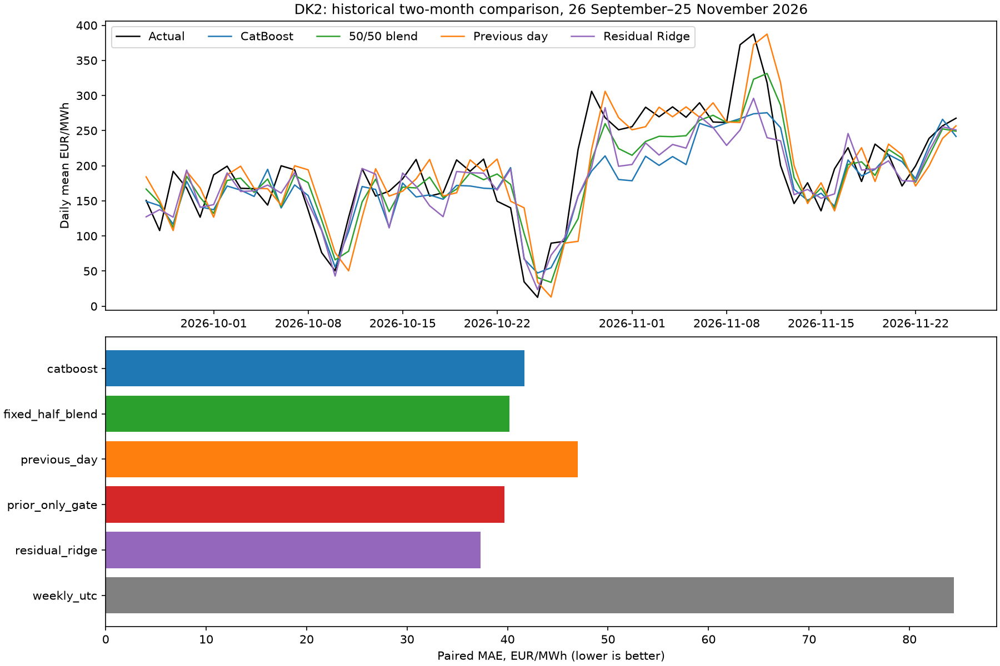

# DK2 electricity-price forecasting

Can a price-history model beat yesterday's electricity-price curve when
forecasting tomorrow's DK2 day-ahead prices?

This Python research project forecasts every 15-minute interval of the next
Danish delivery day at **10:00 Europe/Copenhagen**, with a declared **09:50 input
cutoff** for the research workflow. Prices are **EUR/MWh**. UTC delivery keys
preserve all 92, 96 or 100 intervals across clock changes.

It combines archived [Energinet DayAheadPrices](https://www.energidataservice.dk/tso-electricity/DayAheadPrices), chronological backtests, persistence
benchmarks, uncertainty evaluation and a FastAPI interface for stored results.
The evidence is historical research. Profitable trading and prospective accuracy
have not been established.

## Results and their limits

The latest experiment compares **26 September–25 November 2026**, with **61 days
and 5,860 identical paired intervals**. All methods have 100% forecast coverage.

| Method | MAE EUR/MWh ↓ | Within ±€25 | Within ±€50 |
|---|---:|---:|---:|
| Previous Danish day | 47.01 | 38.7% | 62.9% |
| Original CatBoost | 41.71 | 42.5% | 69.2% |
| Fixed 50/50 blend | 40.18 | 42.3% | 69.6% |
| Prior-only gate | 39.70 | 43.0% | 70.2% |
| Residual Ridge challenger | **37.29** | **46.6%** | **72.5%** |

Residual Ridge reduces MAE by 20.7% against the previous-day benchmark and 10.6%
against CatBoost in this window. Its alpha was selected on earlier chronological
folds; gate and calibration updates use earlier outcomes only. The original
CatBoost forecasts retain their exact saved predictions and weekly refit policy.

**These dates were already observed.** The comparison is retrospective and
selection-affected, not an untouched test. The previous-day benchmark still wins
on extreme prices: MAE €63.28 versus €77.92 for Residual Ridge. No negative-price
intervals occur in this window, so it cannot establish improvement in that regime.



The [full two-month report](reports/two-month-2026-11-25.md) includes coverage,
RMSE, signed bias, daily wins, price-regime slices and interval calibration.
The earlier [year-to-date replay](reports/year-to-date-2026-11-25.md) covers
1 January–25 November: CatBoost MAE €30.00 versus €35.80 for the previous-day
benchmark, with substantial negative-price and extreme-price weaknesses.
Those figures use different dates and must not be compared as an improvement
from one experiment to the other. See the [experiment index](reports/README.md).

## Try it without downloading market data

Use **Python 3.12**. From regular Windows CMD in the cloned project folder:

```cmd
if not exist ".venv\python.exe" conda create -y -p .venv python=3.12 pip
.venv\python.exe -m pip install -r requirements-lock.txt
.venv\python.exe -m pip install -e . --no-build-isolation
.venv\python.exe scripts\offline_demo.py
.venv\python.exe -m pytest -q
.venv\python.exe -m ruff check .
.venv\python.exe -m ruff format --check .
.venv\python.exe -m pip check
.venv\python.exe scripts\check_publication.py
```

The `.venv\python.exe` layout is a project-local **Conda** environment. For a
standard Python virtual environment, use `.venv\Scripts\python.exe` instead.
The [reproduction guide](docs/reproduction.md) also covers an isolated standard
venv. On Linux, use `python3.12 -m venv .venv` and `.venv/bin/python` for the
equivalent commands. Windows/Linux CI is configured; hosted runs remain pending
until the repository is pushed. See the dated [local verification record](docs/publication-checks.md)
for checks actually executed.

The demo generates **synthetic** prices, validates a DST-spanning range and
saves a labelled historical forecast under ignored `data/demo`. It needs no
credentials or network and demonstrates the pipeline, not forecasting skill.
Installation and these commands do not register scheduled tasks.

## Reproduce real-data experiments

Start with a one-week capture, including the autumn clock change:

```cmd
.venv\python.exe -m dk2_forecast.ingestion 2025-10-22 2025-10-29
```

The command prints the validated Parquet path. Raw API responses, manifests,
models, forecasts and receipts stay under ignored `data`. Exact historical
reproduction requires the original captured responses; a new download can
contain revisions. A fresh clone intentionally contains no bulk price archive
or trained models.

The [reproduction guide](docs/reproduction.md) contains commands for the
original diagnostic experiment, retained-source annual replay and two-month
challengers. The two-month comparison consumes the verified annual replay;
new clones must reconstruct that prerequisite before running it. Included
configuration and source bundles preserve candidate implementation provenance,
but cannot recreate missing historical data vintages or live receipts.

## Forecast and evaluation contract

- **Primary benchmark:** previous Danish delivery date at the same local clock
  time; earlier UTC occurrence when ambiguous; weekly UTC fallback when missing.
- **Inputs:** historical DK2 prices and calendar features. Training labels must
  precede the refit origin; features must respect the declared issue cutoff.
- **Historical assumption:** archived issue-day delivery prices are assumed
  available before cutoff. First-publication and revision vintages are unknown.
- **Research candidate:** expanding-history CatBoost with seven-day point-model
  refitting. The Residual Ridge challenger has not replaced the frozen candidate.
- **Operations:** manual by default. No eligible live publications are included
  in these research results. Replays retain actual creation timestamps and are
  excluded from prospective scoring; missed days remain missed.
- **Optional inputs:** weather and ENTSO-E forecast collectors exist separately.
  Verified eligible vintages and, where required, credentials are needed. No
  realized target-day load, weather or generation substitutes for forecasts.

See the [model card](docs/model-card.md), [research protocol](docs/research.md),
[availability assumptions](docs/availability.md) and
[operations guide](docs/operations.md). The API serves saved prices, forecasts
and selected evaluation metadata; serving does not train or schedule jobs.

## Project layout

| Path | Purpose |
|---|---|
| `dk2_forecast/` | Validation, features, models, evaluation and API |
| `scripts/` | Replay, reporting, offline demo and explicit operational commands |
| `tests/` | Offline regression and integration tests |
| `configs/` | Frozen policies and retained implementation provenance |
| `reports/` | Dated research summaries, metrics and figures |
| `docs/` | Reproduction, operations, model limitations and publication review |
| `data/` | Local generated artifacts; excluded from Git |

Project code is MIT licensed. Energinet and optional third-party data retain
their own terms and attribution requirements; see [data sources](docs/availability.md).
For changes, see [contributing](CONTRIBUTING.md). The [publication guide](docs/release.md)
describes the local file audit and release checks. This repository contains no
order-execution or broker integration.
