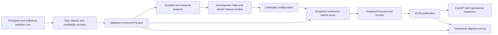

# Reproduction and experiment reference

The primary question is whether a model improves on the previous Danish day's
price curve at the 10:00 Copenhagen issue. The September–November scores below
are diagnostic evidence already used in development. The frozen live plan and
the new research comparison use distinct versioned artifacts.

See [research design](research.md), [input availability](availability.md),
[operational recovery](operations.md), and the [release procedure](release.md).
The [operational audit](audit.md) records missed live runs and the
explicitly labelled first-day replay.

The [operational follow-up](../reports/operational-followup.md) records evaluation
identity/recovery fixes, tail analysis, interval benchmarks and nested searches.
The separate research evaluation covers **20 November 2026–14 January 2027**.
Automatic tasks were disabled at the user's request on 25 November. No eligible
live publications were saved. Retrospective replay results remain separate.
The original frozen comparison and its missed days are preserved.

The forecast covers the next Danish delivery day and is issued at 10:00
Europe/Copenhagen. Each output row represents a 15-minute delivery interval in
Eastern Denmark (DK2). Prices and errors are in EUR/MWh.

## Reproduce a historical forecast on Windows

Run these commands from the checkout in Windows CMD with Conda on PATH. If the
checkout already has the project-local Conda environment, activate it with
`conda activate .\.venv`.

```cmd
if not exist ".venv\python.exe" conda create -p .venv python=3.12 pip
.venv\python.exe -m pip install -r requirements-lock.txt
.venv\python.exe -m pip install -e . --no-build-isolation
.venv\python.exe -m pytest -q
.venv\python.exe -m ruff check .
.venv\python.exe -m ruff format --check .
```

The smoke check reads one day. The pilot archives one week and includes the
100-interval autumn clock change. Ingestion takes an inclusive start and an
exclusive end, both Danish delivery dates.

```cmd
.venv\python.exe scripts\smoke_api.py 2026-10-05
.venv\python.exe -m dk2_forecast.ingestion 2025-10-22 2025-10-29
.venv\python.exe -m dk2_forecast.ingestion 2025-10-22 2025-10-29 --offline
.venv\python.exe -m dk2_forecast.ingestion 2025-10-01 2026-11-16
```

Use the full snapshot path printed by the final command in place of
`PATH_PRINTED_BY_INGESTION`. The archived responses in `data\raw` let you rerun
the full command with `--offline` and recover the same version from a fresh
checkout. Keep those captures for exact replay. A fresh download can reflect
revised prices or changed response metadata.

```cmd
set "DK2_PRICES=PATH_PRINTED_BY_INGESTION"
.venv\python.exe -m dk2_forecast.backtest "%DK2_PRICES%"
.venv\python.exe scripts\replay_historical.py "%DK2_PRICES%" 2026-10-25 --train-for 2026-09-21
```

The last command reproduces the backtest forecast for the 100-interval delivery
day of 25 October 2026. Its issue time is 08:00 UTC on 24 October, equivalent to
10:00 in Copenhagen. Keep `--train-for` at the relevant fold start to reproduce a
backtest prediction. Omit it to fit a fresh expanding model at the forecast's
issue. The CLI prints the saved Parquet location. For bit-for-bit reproduction
use the same pinned dependency versions and platform.

## Data and versions

The source is Energinet's [DayAheadPrices dataset](https://www.energidataservice.dk/tso-electricity/DayAheadPrices).
Ingestion archives each successful HTTP response body before validation and
uses the API's [Danish-local date bounds](https://energidataservice.dk/guides/api-guides).
Historical requests cover at most 84 days each and resume from existing raw
captures. Deduplication uses `(price_area, delivery_start_utc)`. Values that
agree for a key collapse into a single row. Conflicting prices, missing or
unexpected quarter-hours, invalid values and incorrect areas fail validation
before a Parquet snapshot is published. Negative prices are retained.

Danish local midnight and the following local midnight determine the range
in UTC. Regular days have 96 quarters, spring clock-change days have 92, and
autumn clock-change days have 100. UTC distinguishes the repeated local hour.

`data/prices/<data_version>/manifest.json` contains the date range and all raw
capture SHA-256 hashes. The manifest SHA-256 is the data version. The paired
`prices.parquet` is sorted by UTC start and queryable through DuckDB. If a saved
capture fails validation, keep it for diagnosis and rerun with a new
`--root` for a fresh capture. Each forecast stores the issue timestamp, training
origin, baseline version, data version and LightGBM model hash. The matching
LightGBM text file is saved under `data/models`.

## Original model and diagnostic period

The baseline uses the price exactly 168 hours before delivery in UTC. A missing
lag yields a null prediction. LightGBM uses local quarter-hour, weekday, month
and UTC offset, plus UTC price lags of 24, 48, 72, 168, 336 and 672 hours.
It uses CPU, one thread, a fixed seed and 160 rounds of absolute-error training.
Missing lag features are passed as NaN. Every forecast has a row for every
expected interval.

For delivery day D, the issue time is 10:00 on D−1. The historical replay
assumes that the prices for all of D−1 are available by then because their
auction ran on D−2. The auction for D normally publishes after the cutoff.
A calendar-day availability check also blocks a 24-hour UTC lag that lands
inside D on an autumn clock-change day. The backfill gives historical values
without first-publication or revision timestamps, so replay assumes those
values match what was visible at each cutoff. [Nord Pool publication schedule](https://www.nordpoolgroup.com/en/trading/transition-to-15-minute-market-time-unit-mtu/faq/faq-premium-container/will-the-publication-time-of-results-change-after-the-sdac-15-minute-mtu-go-live/)

Development evaluation starts 1 January 2026 with expanding training history
and 28-day evaluation blocks. The initial fit uses records from 1 October
2025. Each fit only uses training labels for delivery days known at its first
issue. The original 56-day chronological test starts 21 September 2026 and
ends 15 November 2026. The fit remains fixed throughout that period, which
serves as a diagnostic benchmark for the follow-up experiment.
Lag features update as prices become available at each simulated issue.

The backtest writes paired forecasts to `forecasts.parquet` and metrics to
`report.json` under the printed output directory. Coverage uses all expected
delivery intervals as its denominator. Both MAEs use the same intervals with an
actual and both predictions. Separate slices use actual prices below zero or
at least 200 EUR/MWh. Worst examples give the peak absolute error from up to
three distinct delivery days per method.

### Observed results

The source snapshot covers 1 October 2025 through 15 November 2026 and
contains 39,460 unique intervals. Both methods had 100% forecast coverage
in development and in the diagnostic period. MAE is in EUR/MWh.

| Period and actual-price slice | Paired intervals | Weekly baseline MAE | LightGBM MAE |
| --- | ---: | ---: | ---: |
| Development, all | 25,244 | 40.39 | 30.10 |
| Development, negative | 371 | 33.56 | 34.75 |
| Development, spikes | 1,202 | 103.20 | 96.02 |
| Diagnostic, all | 5,380 | 83.74 | 64.71 |
| Diagnostic, negative | 0 | — | — |
| Diagnostic, spikes | 2,258 | 92.26 | 98.01 |

LightGBM reduced diagnostic MAE by 22.7% against the weekly baseline.
It underpredicted the 22 September
2026 17:15 UTC spike at 223.74 EUR/MWh against an actual 651.40. The weekly
baseline carried a prior-week spike into 21 September 2026 17:15 UTC,
predicting 717.52 against an actual 222.77.

The observed data version is
`e92c30111d006847b1c84547b477166466571e7e907480dbd15ae525eb943f53`.
The standalone 25 October forecast replay matched all 100 backtest rows.

## Serve stored results

```cmd
set "DK2_FORECASTS=data\forecasts"
.venv\python.exe -m uvicorn dk2_forecast.api:create_app --factory
```

From another CMD window, request the stored price and forecast. To serve a
whole backtest instead, set `DK2_FORECASTS` to its `forecasts.parquet`.

```cmd
curl.exe http://127.0.0.1:8000/prices/2026-10-25
curl.exe http://127.0.0.1:8000/forecasts/2026-10-25
```

Forecast requests can filter by `model_version` or `data_version`. Open
`http://127.0.0.1:8000/docs` for the FastAPI interface.

## Run the daily forecast

Select the frozen research evaluation and use the plan-aware scheduler described
in [operations](operations.md). It supplies explicit paths, bounded dates,
logging and retained execution. Earlier standalone issue commands remain legacy
utilities; they are not the active prospective evaluation.

## Previous-day benchmark experiment

The previous-day benchmark matches each target to the same Danish clock
time on the preceding Danish delivery date. It takes the earlier UTC
occurrence of an ambiguous source slot. If that source is missing or
unavailable at issue time, it uses the 168-hour UTC lag when available and
counts a fallback. This affects four slots on the Monday after the spring
clock change. On the autumn delivery day itself, a 24-hour UTC subtraction
would read the target day's first hour for the last four intervals. Those
features are masked at the cutoff, and the previous-day benchmark uses the
preceding day's matching clock time.

The original 5,380-interval window is a diagnostic with a single fit on
21 September 2026. Its three rounded reference MAEs are checked before
tuning begins. The feature ablation adds one previous-day column to the
original LightGBM configuration. Elastic Net, LightGBM and CatBoost then
use the same 11 inputs, including that column. Elastic Net's median
imputation, missing indicators and scaling are fit on each training fold.
The trees handle missing values in their own fit.

Selection uses the ten expanding 28-day development blocks from 1 January
through 20 September 2026, with a truncated last block. Models fit once per
block, and lag inputs update at every daily issue. The objective is pooled
out-of-fold MAE on intervals covered by both baselines and the candidates.
Elastic Net uses nine `alpha` and `l1_ratio` combinations. Both CPU tree
searches use seed 42, sequential Optuna TPE and at most 30 trials each. The
wall-time limit takes effect between trials. Runtime can change how many
trials finish, so reproduce the exact selected models from the saved report
or freeze file. [Optuna TPE documentation](https://optuna.readthedocs.io/en/stable/reference/samplers/generated/optuna.samplers.TPESampler.html)

The report saves fold dates, parameters, seeds, trial and fit runtimes,
method coverage, paired MAE, and shares within 25 and 50 EUR/MWh. A delivery-day
win requires lower average error than the previous-day baseline across a
complete paired Danish delivery day. It also reports scores on actuals
at least 200 EUR/MWh, negative actuals, and absolute actuals at or above the
99th percentile of development prices. The extreme threshold is frozen
before any fresh scoring.

### Recorded comparison

Both periods had 100% coverage for every method. Development had 25,244
paired intervals and four weekly fallbacks. The diagnostic had 5,380 paired
intervals and zero fallbacks. MAE is in EUR/MWh.

| Method | Development MAE | Diagnostic MAE |
| --- | ---: | ---: |
| Weekly UTC baseline | 40.39 | 83.74 |
| Previous Danish day | 32.55 | **50.37** |
| Original LightGBM | 30.10 | 64.71 |
| LightGBM + previous-day price | 30.17 | 64.40 |
| Tuned LightGBM | 29.69 | 64.57 |
| Elastic Net | 31.44 | 53.14 |
| Tuned Elastic Net | 29.99 | 53.76 |
| CatBoost | 29.46 | 66.42 |
| Tuned CatBoost | **29.18** | 61.53 |

The CPU searches took 10.7 seconds for nine Elastic Net settings, 107.8
seconds for 30 LightGBM trials and 180.6 seconds for 18 CatBoost trials.
CatBoost reached the 180-second budget during its final completed trial.
The selected CatBoost reduced development MAE by 10.4% relative to the
previous-day baseline and won 149 of 263 delivery days. Its development
shares within 25 and 50 EUR/MWh were 56.5% and 83.5%. The corresponding
baseline shares were 57.9% and 78.3%.

| Actual-price slice | Development n | Previous day / tuned CatBoost MAE | Diagnostic n | Previous day / tuned CatBoost MAE |
| --- | ---: | ---: | ---: | ---: |
| At least 200 EUR/MWh | 1,202 | 85.89 / 93.38 | 2,258 | 50.96 / 92.67 |
| Absolute price at least 276.019989 EUR/MWh | 253 | 194.23 / 219.92 | 738 | 69.94 / 154.34 |
| Below zero | 371 | 9.66 / 32.44 | 0 | — |

### Recreate the experiment files with CMD

Run from the checkout in Windows CMD. The first command activates the
existing project-local Conda environment. Use the setup instructions above
if creating a new environment.

```cmd
conda activate .\.venv
.venv\python.exe -m pip install -r requirements-lock.txt
.venv\python.exe -m pip install -e . --no-build-isolation
.venv\python.exe -m pytest -q
.venv\python.exe -m ruff check .
.venv\python.exe -m ruff format --check .
for /f "delims=" %I in ('.venv\python.exe -m dk2_forecast.ingestion 2025-10-01 2026-11-16 --offline') do @set "DK2_PRICES=%I"
for /f "delims=" %I in ('.venv\python.exe -m dk2_forecast.experiment "%DK2_PRICES%" --trials 30 --timeout 180') do @set "DK2_REPORT=%I"
type "%DK2_REPORT%"
```

Use the ingestion command without `--offline` to fetch the archive on a fresh
machine. The experiment command creates `experiment.json`, `development.parquet`
and `diagnostic.parquet` in its printed report directory. In a `.cmd` file, use
`%%I` for the loop variable.

### Freeze and collect fresh forecasts

Freeze once before the first scheduled forecast, using the development
report or the report produced by the previous commands. This creates
`freeze.json` with a fixed 56-day window, model parameters, package versions,
implementation hash and scoring rules. By default it chooses the earliest
delivery day whose 09:50 preparation can still be scheduled. Pass
`--start YYYY-MM-DD` to choose a later delivery date.

```cmd
for /f "delims=" %I in ('.venv\python.exe -m dk2_forecast.prospective freeze "%DK2_REPORT%"') do @set "DK2_PLAN=%CD%\%I"
type "%DK2_PLAN%"
tzutil /g
powershell -NoProfile -ExecutionPolicy Bypass -File scripts\schedule.ps1 -Plan "%DK2_PLAN%"
powershell -NoProfile -ExecutionPolicy Bypass -File scripts\schedule.ps1 -Plan "%DK2_PLAN%" -CheckOnly
```

For a manual run, execute the two commands at 09:50 and 10:00 Copenhagen
time respectively on the day before delivery.

```cmd
.venv\python.exe -m dk2_forecast.operations prepare "%DK2_PLAN%"
.venv\python.exe -m dk2_forecast.operations publish "%DK2_PLAN%"
```

Preparation records when it verified the full validated price snapshot and
its SHA-256. This establishes that the inputs were observable by the cutoff.
Energinet's historical response lacks market first-publication timestamps
and revision history. Development and diagnostic simulations assume all
prices for the issue day's delivery were known by 10:00 and that archived
values match that vintage. Fresh evaluation locks the actual pre-cutoff
training snapshot at each 28-day block origin. Every candidate then uses
that same snapshot for fitting, with the day's newly captured inputs for
prediction. If a block-origin capture is missed, the block cannot be
started retrospectively.

For example, once actuals for 18 November are available, ingest through that
delivery date and score the issued artifacts. Set a later exclusive end
date as more actuals become available.

```cmd
for /f "delims=" %I in ('.venv\python.exe -m dk2_forecast.ingestion 2025-10-01 2026-11-19') do @set "DK2_ACTUALS=%I"
.venv\python.exe -m dk2_forecast.prospective score "%DK2_PLAN%" "%DK2_ACTUALS%"
```

The scorer checks pre-cutoff preparation and publication receipts. It
includes missed delivery days in coverage, scores identical paired
intervals, and marks reports as partial until actuals cover the frozen
window. The JSON is written under the plan's `scores` directory.

## Reproduce the release research

The project-local Conda environment remains the reference. A complete package
lock is provided for a clean Python 3.12 environment. These commands use CMD
loop variables. In a batch file replace `%I` with `%%I`.

```cmd
rem Run from the cloned project folder.
.venv\python.exe -m venv .reproduction-env
.reproduction-env\Scripts\python.exe -m pip install -r requirements-lock.txt
.reproduction-env\Scripts\python.exe -m pip install -e . --no-build-isolation
.reproduction-env\Scripts\python.exe -m pytest -q
.reproduction-env\Scripts\python.exe -m ruff check .
.reproduction-env\Scripts\python.exe -m ruff format --check .
.reproduction-env\Scripts\python.exe scripts\offline_demo.py
```

The offline demo generates synthetic prices locally, checks DST handling and
creates a labelled replay. It makes no live requests.

```cmd
for /f "delims=" %I in ('.venv\python.exe -m dk2_forecast.ingestion 2025-10-01 2026-11-16') do @set "DK2_PRICES=%I"
.venv\python.exe -m dk2_forecast.audit_snapshot "%DK2_PRICES%"
for /f "delims=" %I in ('.venv\python.exe -m dk2_forecast.research "%DK2_PRICES%" --trials 30 --timeout 180') do @set "DK2_RESEARCH=%I"
.venv\python.exe -m dk2_forecast.research_plots "%DK2_RESEARCH%"
.venv\python.exe -m dk2_forecast.explanatory 2026-06-01 2026-09-21 --historical-assumption
.venv\python.exe -m dk2_forecast.weather_ablation "%DK2_RESEARCH%" "%DK2_PRICES%"
.venv\python.exe -m dk2_forecast.research_diagnostic "%DK2_RESEARCH%" "%DK2_PRICES%"
.venv\python.exe scripts\verify_research.py "%DK2_RESEARCH%" "%DK2_PRICES%"
```

Tree studies resume from `data/research/studies.sqlite3` with a local sampler
checkpoint. Store these artifacts to reproduce a time-limited search.
The report records each trial's state, parameters, training window, fold dates
and runtimes. Repeating a 180-second search on another machine can complete a
different number of trials. Saved parameters and predictions establish the
recorded experiment.

The weather command labels historical availability as assumed and records
missing runs. For live collection, omit `--historical-assumption` and request
a future delivery day before its snapshot cutoff. The first live weather
capture in this checkout is for 20 November 2026.

The new research artifact provides a separate candidate with quantiles.
Historical forecasting explicitly records replay status and its actual
creation timestamp.

```cmd
for /f "delims=" %I in ('.venv\python.exe -m dk2_forecast.ingestion 2025-10-01 2026-11-19') do @set "DK2_ACTUALS=%I"
for /f "delims=" %I in ('.venv\python.exe -m dk2_forecast.research_forecast replay "%DK2_RESEARCH%" 2026-11-18 --prices "%DK2_ACTUALS%"') do @set "DK2_REPLAY=%I"
.venv\python.exe -m dk2_forecast.research_forecast score "%DK2_RESEARCH%" 2026-11-18 --prices "%DK2_ACTUALS%" --forecast "%DK2_REPLAY%"
```

Use the explicit evaluation workflow in [operations](operations.md).
`research_ops freeze REPORT` computes the earliest feasible future origin and
returns an evaluation-specific freeze.json. The same candidate may start a
new future evaluation without changing any earlier freeze. Preparation,
publication, collection and scoring use the evaluation's retained launch.py.
Set `DK2_EXPERIMENT` to its directory to discover issued forecasts and scores.
The old report-only live commands are compatibility entry points for legacy
artifacts; they do not select a new evaluation.

For source corrections, use the same ingestion dates with `--refresh`.
Raw objects, retrieval receipts and the resulting data version are retained.
Default ingestion continues to replay its original capture. Use
`audit_snapshot` to verify a retained snapshot against raw hashes and values.

## Architecture



The code is MIT licensed. Data retain their providers' terms and attribution.
Bulk artifacts, environments, local tool configuration and credentials are
excluded from Git.

The [recorded research report](../reports/research.md) contains the point,
interval and conditional weather results and failure-case figures. Its JSON
summary is retained alongside the Markdown. To rebuild it after the commands
above, set the two JSON paths printed by the ablation and diagnostic commands:

```cmd
set "DK2_WEATHER=data\research\803ba646661d6a4f4691f305e8c00dac5384e7022751f4c5a0dbfb0f065ef02a\ablations\4dbf1efd6c5eb4f48888289c73a71a13cab91a5be37bda46bce077b8b101f193.json"
set "DK2_DIAGNOSTIC=data\research\803ba646661d6a4f4691f305e8c00dac5384e7022751f4c5a0dbfb0f065ef02a\diagnostics\a65c25469f36e22dcf0920b8862040eecd01ae4020ab02c7a5a63acf59c60195.json"
.venv\python.exe scripts\build_report.py "%DK2_RESEARCH%" --weather "%DK2_WEATHER%" --diagnostic "%DK2_DIAGNOSTIC%"
```

The paths above identify this checkout's recorded experiment. A rerun prints
new paths because runtime and creation metadata are versioned. Runtime
logs and source ZIP snapshots remain under ignored `data`, and the public
summary contains no credentials.

## Inspect the selected research evaluation

```cmd
rem Run from the cloned project folder.
set "DK2_PLAN=data\research_live\evaluations\f23d494fd3e14712135466641812f37c92fbbf58e0fa319bae24391336b7f95c\freeze.json"
for %I in ("%DK2_PLAN%") do @set "DK2_EVAL=%~dpI"
powershell -NoProfile -ExecutionPolicy Bypass -File scripts\schedule.ps1 -Plan "%DK2_PLAN%" -CheckOnly
.venv\python.exe -I "%DK2_EVAL%launch.py" inspect "%DK2_PLAN%" --root "%CD%\data"
```

Use the [operations guide](operations.md) for serving, actuals collection,
whole-window scoring and a new evaluation of the retained candidate after a
missed origin. Scheduled research execution uses the retained source and package
versions, so ongoing development cannot silently change the live model.
The [follow-up JSON](../reports/operational-followup.json) records reference artifact
hashes, conditional errors, raw/operational interval diagnostics and search phases.

## Replay every delivery day in 2026

The annual comparison produces one complete forecast curve per Danish delivery
day, using that day's preceding delivery-date actual prices and eligible older
history. It retains the selected expanding-history CatBoost parameters and its
seven-day Friday refit cycle anchored to 20 November. Daily inputs are refreshed;
prior predictions are never fed back as actual prices. Models use CPU and one
training thread. Both 92/100-quarter clock-change days are validated.

From regular Windows CMD in this checkout, reproduce the exact retained snapshot:

```cmd
rem Run from the cloned project folder.
set "DK2_YEAR_PRICES=data\prices\98cbae7df46931e31b00073d145c553cf21c09dfe64a7cd3b582ca4a9ad0b2d6\prices.parquet"
.venv\python.exe -I scripts\replay_year.py --prices "%DK2_YEAR_PRICES%" --start 2026-01-01 --end 2026-11-26
```

The end date is exclusive: this evaluates 1 January through 25 November, 329
days and 31,584 quarter-hours. October–December 2025 supply warm-up history.
The selected candidate's retained source ZIP, plan/report and pinned environment
are required. A fresh download may contain revised prices and create a different
data/replay version. With retained raw inputs, recreate the snapshot offline;
otherwise the ingestion command prints the path to a new validated capture:

```cmd
for /f "delims=" %I in ('.venv\python.exe -m dk2_forecast.ingestion 2025-10-01 2026-11-26') do @set "DK2_YEAR_PRICES=%I"
.venv\python.exe -I scripts\replay_year.py --prices "%DK2_YEAR_PRICES%" --start 2026-01-01 --end 2026-11-26
```

The run prints a versioned directory under data/year_replays. It contains full
interval comparisons in CSV/Parquet, daily/monthly scores, replay receipts,
model caches, report.md, hashed JSON reports and figures. Repeating the same
command reuses checked models and preserves daily forecasts/receipts. If a
process is terminated, inspect its process state before removing that run's
stale run.lock. Ordinary exceptions clean up its lock. The command creates no
automatic task and does not change prospective evaluation artifacts.

The whole comparison is a retrospective replay. Parameters were selected using
some of these dates, and historical price revision/publication vintages are
unverified. The report separates earlier development, candidate selection,
previously observed diagnostics and post-freeze dates already replayed manually.
These categories cannot be pooled into an untouched annual test. Publication
claims must retain these limitations and show negative/extreme errors, losing
months and the persistence benchmark. MAE alone does not establish trading P&L.

To reproduce the annual replay from the reviewable public configuration,
restore the small retained source bundle into its runtime location and pass the
public freeze explicitly. The exact research report is retained beside that
freeze so its parameters and hashes can be validated:

```cmd
if not exist data\code\5775ce37204d12901d2b983e69179f20ce8a7b384cf6b0671de173d226f931dc mkdir data\code\5775ce37204d12901d2b983e69179f20ce8a7b384cf6b0671de173d226f931dc
copy /Y configs\retained_sources\5775ce37204d12901d2b983e69179f20ce8a7b384cf6b0671de173d226f931dc\source.zip data\code\5775ce37204d12901d2b983e69179f20ce8a7b384cf6b0671de173d226f931dc\source.zip
.venv\python.exe -I scripts\replay_year.py --plan configs\evaluations\f23d494fd3e14712135466641812f37c92fbbf58e0fa319bae24391336b7f95c\freeze.json --prices "%DK2_YEAR_PRICES%" --start 2026-01-01 --end 2026-11-26
```

These files contain code, configuration and aggregate research metadata. Raw
price archives and trained models remain under ignored data. Provider data
terms and attribution still apply. The replay command never registers tasks.


The [2026 year-to-date review](../reports/year-to-date-2026-11-25.md) now compares
all 329 delivery days through 25 November. CatBoost reduces historical MAE by
16.2% against the previous-day benchmark, with important negative-price,
high-price and November weaknesses. This is selection-affected retrospective
research, and the report preserves that limitation. No GitHub upload has occurred.

## Two-month improvement experiment

The [two-month report](../reports/two-month-2026-11-25.md) evaluates 26 September
through 25 November 2026: 61 days and 5,860 paired quarter-hours, including the
100-interval clock-change day. It reuses the exact saved annual CatBoost forecasts
and adds a fixed blend, prior-only gate and residual Ridge model. Ridge alpha is
selected on earlier chronological folds; gate weights and interval calibration
update weekly using earlier outcomes only. This is another retrospective,
selection-affected comparison, separate from the unchanged frozen evaluation.

Residual Ridge MAE is EUR 37.29/MWh versus CatBoost 41.71 and previous-day 47.01.
The fixed blend handles high prices better, while the previous-day benchmark
still beats every challenger on extreme prices. This window has no negative
prices, so it cannot verify improvement in that regime. Full coverage, daily
wins, signed bias, accuracy bands, uncertainty calibration and limitations are
reported alongside the averages. Fundamentals without eligible archived forecast
vintages and trading P&L without a defined strategy are excluded.

Run from regular Windows CMD, using the existing audited annual replay:

```cmd
rem Run from the cloned project folder.
set "DK2_REPLAY=data\year_replays\8606b681b3bdea2401ac8f3981e206329d2e9ee74f25ed23659f0bdf83ae2aa0"
set "DK2_PRICES=data\prices\98cbae7df46931e31b00073d145c553cf21c09dfe64a7cd3b582ca4a9ad0b2d6\prices.parquet"
.venv\python.exe -I scripts\compare_two_months.py --replay "%DK2_REPLAY%" --prices "%DK2_PRICES%" --start 2026-09-26 --end 2026-11-26
set "DK2_TWO_MONTH=data\two_month\1fc14f15946fc4869e1db695e5e19e5cf9425ec4d97d5ff3eb90414c2df20fca"
.venv\python.exe -I scripts\report_two_months.py "%DK2_TWO_MONTH%"
type "%DK2_TWO_MONTH%\selection.json"
type "%DK2_TWO_MONTH%\independent-verification.json"
```

The comparison prints its output directory; use that directory if the source,
environment or input hashes change. The end date is exclusive. The reporting
command targets this dated two-month report. Daily reference receipts, price
snapshot, UTC grid and lag inputs are checked before fitting. New models are
cached by origin/configuration within the versioned run; training hashes are
verified on resume. A completed identical run verifies its existing predictions
and returns without refitting. Local generated pickle caches are trusted project
artifacts; do not import caches from an untrusted source.

Predictions and uncertainty bounds are saved in CSV/Parquet, with a creation
timestamp, hashed source/policy, fit records, inner selection scores, gate weights,
calibration records and replay eligibility flags. `report_two_months.py` checks
the saved hashes and independently reproduces metrics using DuckDB. Source
snapshots and intermediate results stay under ignored `data/two_month`.
Neither command registers tasks or publishes prospective forecasts. Earlier
annual output and frozen receipts are preserved. To reconstruct its prerequisite
on another checkout, follow the annual replay instructions above; no new full-year
fit is needed in this checkout.
