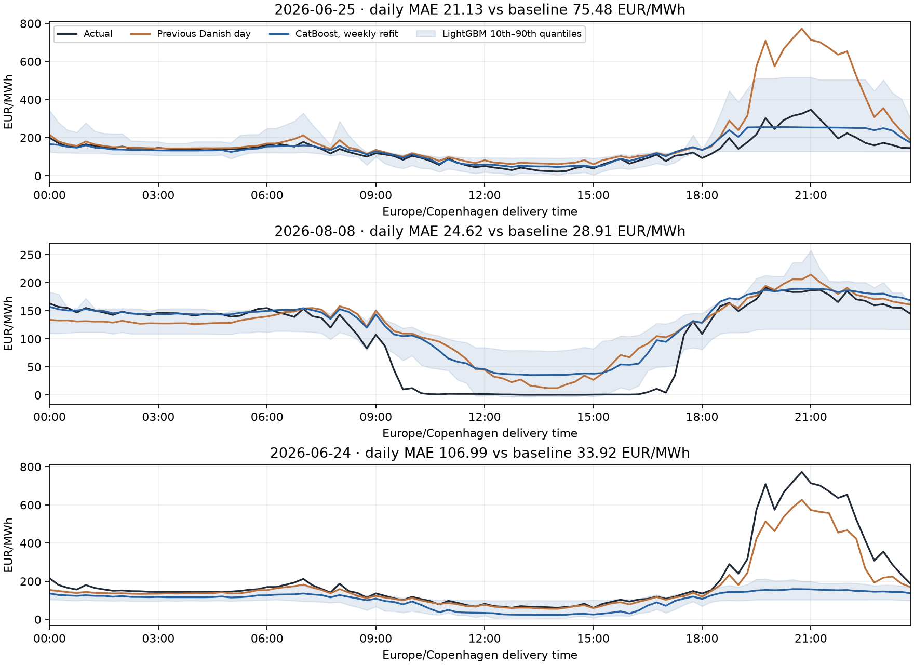
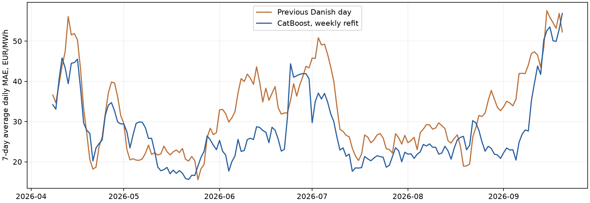
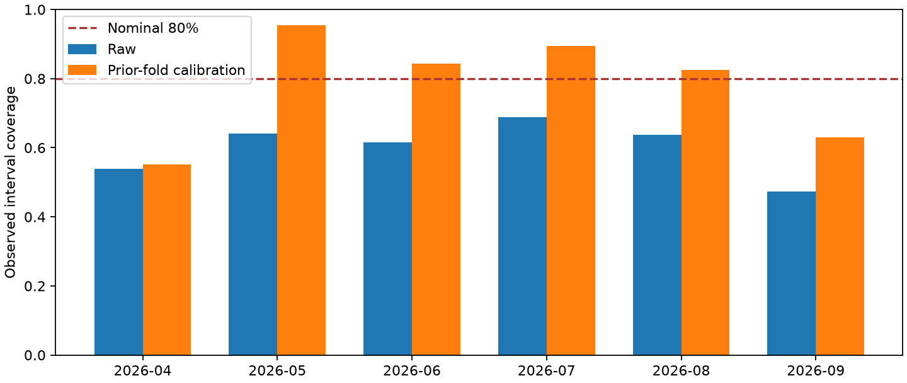

# DK2 price-curve experiment

Development used 2 April through 20 September 2026, with 16,512 quarter-hours. Every method is scored on identical paired intervals against the previous Danish day.

| Method | Coverage | MAE | RMSE | Within €25 | Within €50 | Day wins |
| --- | ---: | ---: | ---: | ---: | ---: | ---: |
| previous_day | 100% | 32.52 | 50.94 | 57.8% | 78.3% | 0 |
| weekly_utc | 100% | 40.95 | 60.98 | 46.8% | 70.6% | 63 |
| weekday_persistence | 100% | 34.19 | 53.16 | 56.2% | 77.5% | 34 |
| catboost | 100% | 29.17 | 44.81 | 57.3% | 83.6% | 97 |
| catboost_tuned | 100% | 29.12 | 44.57 | 57.3% | 84.0% | 104 |
| correction | 100% | 29.83 | 45.20 | 56.5% | 83.8% | 103 |
| fixed_ensemble | 100% | 28.27 | 42.56 | 57.8% | 85.8% | 105 |
| lightgbm | 100% | 29.45 | 45.09 | 57.9% | 82.9% | 98 |
| lightgbm_squared | 100% | 33.03 | 51.46 | 53.4% | 80.6% | 93 |
| lightgbm_tuned | 100% | 29.45 | 45.09 | 57.9% | 82.9% | 98 |
| oof_ensemble | 100% | 28.41 | 43.35 | 58.3% | 85.2% | 106 |
| ridge | 100% | 37.48 | 51.50 | 44.8% | 74.6% | 72 |
| ridge_tuned | 100% | 30.36 | 44.27 | 52.8% | 84.5% | 88 |
| weekly_refit | 100% | 28.11 | 43.95 | 59.6% | 84.6% | 104 |

MAE and RMSE are in EUR/MWh. This development result includes model selection and is optimistic.
The research proposal is weekly_refit, using expanding history and 7-day point-model refitting. The original frozen live candidate remains CatBoost.

## Window comparison

| History | MAE | Fit seconds |
| --- | ---: | ---: |
| window_12 | 31.74 | 11.6 |
| window_26 | 30.15 | 26.5 |
| window_8 | 31.57 | 7.1 |
| window_expanding | 29.45 | 36.7 |

## Search budgets

| Tree | Completed | Failed | Seconds |
| --- | ---: | ---: | ---: |
| catboost | 1 | 0 | 191.9 |
| lightgbm | 4 | 0 | 186.5 |

Each search had a ceiling of 30 sequential trials and a 180-second budget. A trial may finish beyond the budget. Stored studies retain trial parameters, fold dates and state.

## Price regimes

| Slice | Paired intervals | Previous day MAE | Research proposal MAE |
| --- | ---: | ---: | ---: |
| extreme | 166 | 200.19 | 228.18 |
| negative | 350 | 7.97 | 37.54 |
| spike | 852 | 79.54 | 86.14 |

The development extreme threshold is |actual| ≥ 276.019989 EUR/MWh. The high-price threshold is 200 EUR/MWh.
Paired daily MAE difference was -4.41 EUR/MWh, with a seven-day block-bootstrap 95% interval [-6.78, -2.11]. This interval is unadjusted for model selection and multiple comparisons.

## Quantile calibration

| Interval | Observed coverage | Mean width EUR/MWh | Raw crossings |
| --- | ---: | ---: | ---: |
| quantiles | 60.8% | 69.65 | 693 |
| calibrated_quantiles | 79.5% | 97.02 | 0 |

The nominal coverage is 80%. Calibration uses prior validation folds. The aggregate improvement hides substantial monthly variation, including undercoverage in September. Temporal dependence limits exchangeability guarantees.

## Conditional weather ablation

The common sample contains 10,656 intervals (64.5% of development). Historical run availability is assumed eight hours after initialization.

| Features | MAE EUR/MWh |
| --- | ---: |
| price_calendar_11 | 30.38 |
| price_curves | 29.09 |
| plus_temperature | 29.17 |
| plus_temperature_wind | 29.38 |
| plus_temperature_wind_radiation | 29.18 |
| plus_weather_linear_interpolation | 29.18 |

## Already observed diagnostic

These 5,380 intervals cover 21 September through 15 November 2026 and were already inspected.

| Method | MAE EUR/MWh |
| --- | ---: |
| catboost_tuned | 45.87 |
| correction | 43.10 |
| lightgbm_squared | 41.90 |
| lightgbm_tuned | 44.71 |
| previous_day | 50.37 |
| ridge_tuned | 39.71 |
| weekday_persistence | 72.91 |
| weekly_utc | 83.74 |

## Operational status and remaining work

The original frozen comparison has no eligible publication for 18 or 19 November. Those days are recorded as missed. The next original training block begins with delivery 16 December.
A separately labelled 18 November replay verified the five-method forecast and scoring path. Its full table appears in the [operational audit](../docs/audit.md).

Historical source vintages remain assumptions. Eligible load and renewable forecasts require versioned collection and access credentials. Neighbour and interconnector integrations, seasonal coverage, confirmatory comparison tests, and neural models remain subsequent work.

Price data version e92c30111d006847b1c84547b477166466571e7e907480dbd15ae525eb943f53.
Full experiment artifact 803ba646661d6a4f4691f305e8c00dac5384e7022751f4c5a0dbfb0f065ef02a.
The saved JSON additionally contains signed errors, absolute-error percentiles, local calendar groups, pinball losses, hourly calibration, runtime and bootstrap details. See the README for reproduction commands.

## Operational follow-up

The separate prospective evaluation now covers 20 November 2026–14 January 2027.
Its first 19 November execution is pending. The original comparison remains
unchanged. See [operational follow-up](operational-followup.md) for the exact
identities, schedule checks, same-interval tail comparison, interval scores and
startup/adaptive search accounting. The candidate's negative/extreme weaknesses
remain visible; exploratory blends and gates have not replaced it.
