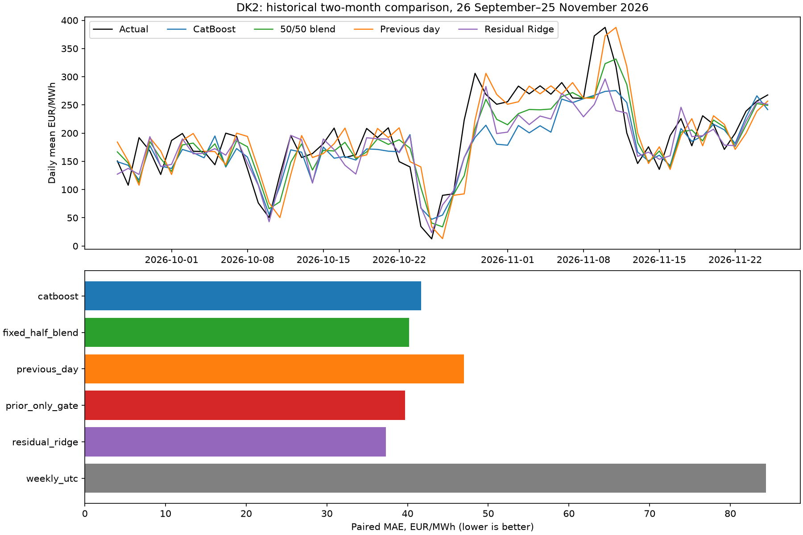

# Two-month price-only improvement experiment

26 September–25 November 2026 inclusive: 61 Danish delivery days, 5,860 unique UTC quarter-hours. All six methods and actuals have 100% coverage on the same intervals. October 25 has 100 intervals. This window was chosen before running these new comparisons to include the latest complete two months and November's known weakness.

**Retrospective, selection-affected research.** These dates were already examined in the annual replay. No prospective evidence or trading-profit claim is produced. The frozen evaluation, candidate and receipts are unchanged; no scheduled tasks are registered or enabled.

## Point results

| Method | MAE EUR/MWh | RMSE | Bias (prediction − actual) | Within ±25 | Within ±50 | Day wins vs previous day |
|---|---:|---:|---:|---:|---:|---:|
| catboost | 41.71 | 57.08 | -19.99 | 42.5% | 69.2% | 42/61 |
| fixed_half_blend | 40.18 | 54.05 | -10.67 | 42.3% | 69.6% | 43/61 |
| previous_day | 47.01 | 63.05 | -1.36 | 38.7% | 62.9% | 0/61 |
| prior_only_gate | 39.70 | 53.69 | -11.18 | 43.0% | 70.2% | 44/61 |
| residual_ridge | 37.29 | 51.53 | -15.73 | 46.6% | 72.5% | 42/61 |
| weekly_utc | 84.44 | 107.98 | -11.50 | 23.1% | 39.0% | 15/61 |

## Stress conditions

Slices overlap. Extreme means absolute actual price ≥ the previously frozen development threshold of €276.019989/MWh. Realized regimes are used for scoring only.

| Slice | Paired intervals | catboost | fixed_half_blend | previous_day | prior_only_gate | residual_ridge | weekly_utc |
|---|---:|---:|---:|---:|---:|---:|---:|
| negative | 0 | n/a | n/a | n/a | n/a | n/a | n/a |
| spike | 2724 | 55.68 | 43.71 | 45.72 | 48.10 | 47.84 | 93.12 |
| extreme | 817 | 94.67 | 66.97 | 63.28 | 74.11 | 77.92 | 112.47 |

## Monthly MAE

| Month | Intervals | catboost | fixed_half_blend | previous_day | prior_only_gate | residual_ridge | weekly_utc |
|---|---:|---:|---:|---:|---:|---:|---:|
| 2026-09 | 480 | 38.50 | 41.59 | 50.49 | 38.84 | 43.04 | 91.02 |
| 2026-10 | 2980 | 39.42 | 41.01 | 50.08 | 37.63 | 34.20 | 77.17 |
| 2026-11 | 2400 | 45.19 | 38.87 | 42.49 | 42.45 | 39.98 | 92.16 |

## Uncertainty intervals

Nominal coverage is 80%. Lower interval score is better; excessive width is penalized. These are empirical intervals without formal coverage guarantees under temporal dependence or drift. Raw quantiles and their crossing diagnostics remain in the full artifact.

| Method | Intervals | Coverage | Mean width | Interval score | Raw crossings |
|---|---:|---:|---:|---:|---:|
| catboost_residual_56d | 5860 | 77.8% | 120.68 | 195.17 | 0 |
| fixed_development_calibration | 5860 | 66.0% | 132.10 | 258.13 | 0 |
| previous_day_residual_56d | 5860 | 79.1% | 150.97 | 232.58 | 0 |
| raw_lightgbm | 5860 | 56.0% | 105.84 | 283.68 | 106 |
| rolling_quantile_28d | 5860 | 78.1% | 171.18 | 252.22 | 0 |

## What improved and what did not

Residual Ridge has the lowest overall MAE in this comparison: 10.6% below the original CatBoost and 20.7% below the previous-day benchmark. Its November MAE is €39.98/MWh versus CatBoost €45.19 and the benchmark €42.49. The fixed blend is better in November (€38.87) and on high-price intervals (€43.71). No method wins every slice.

Extreme-price MAE remains worse than the previous-day benchmark for every challenger. Residual Ridge still underpredicts by €15.73/MWh on average. There are zero negative-price target intervals, so this run provides no evidence that the known negative-price weakness is fixed. The next test of that claim needs dates containing negative prices.

Rolling quantile calibration raises nominal-80% interval coverage from 56.0% raw (66.0% with the retained fixed margin) to 78.1%, at the cost of wider intervals. The simple CatBoost historical-residual interval achieves 77.8% coverage and a better interval score with narrower bounds. Calibration remains conditional on this already observed period.

Operational and model-only point results coincide: 0 model fallback intervals and 0 previous-day weekly fallback intervals. Gate default weights occur in 9/27 regime/origin blocks; these counts include regimes that may have no target intervals. Per-block sample counts and reasons are retained in gate_weights. Baseline day-win count is zero because it is the reference; its 61 comparisons are ties.

## Prior-only protocol and interpretation

- Original CatBoost forecasts are reused from their hashed daily replay receipts, preserving their exact predictions and weekly Friday origins. Prior-day/weekly values and actuals are checked against the audited price snapshot; target/future price contamination is tested on every reference day.
- The fixed blend gives CatBoost and the previous-day baseline equal weight. It has no fitted weights.
- Residual Ridge uses the same 210 price/calendar features, fitted imputation and scaling within each training origin. Alpha 1000 was chosen from [100, 1000, 10000] on 31 July–24 September chronological weekly validation and saved before outer scoring. Training expands and excludes origin-day labels.
- The gate chooses CatBoost weights from [0, .25, .5, .75, 1] separately for available previous-day prices <0, 0–200 and ≥200. It uses only prior 56-day out-of-fold errors, updates weekly and defaults to 50/50 with fewer than 192 eligible intervals. No actual target regime is an inference input.
- Earlier outer outcomes may enter later weekly gate/calibration updates, as declared before execution. This evaluates a sequential updating policy; it does not evaluate one unchanging fitted gate over all 61 days.
- LightGBM 0.1/0.5/0.9 quantiles use fixed default candidate settings, 160 rounds and expanding training, refitted every 28 days with the declared 20 November anchor. Raw models also run on earlier warm-up dates to provide prior forecast errors. Sorted bounds are compared with the retained development margin and a weekly 28-day prior-only expansion margin. The rolling method falls back to sorted raw bounds with fewer than 14×92 eligible prior intervals.
- Historical-residual benchmarks add prior 56-day residual quantiles to the previous-day or CatBoost point forecast; parameters update weekly. Interval calibration by month, local hour and realized regime, pinball loss and interval scores are in the full JSON.
- Point breakdowns include month, local hour, weekday/weekend, forecast horizon, available previous-day price and predicted price. Large-error examples, daily scores, denominators, gate weights, fallback counts and model/training hashes are retained under data/two_month.
- Historical publication/revision vintages are unavailable: issue-day delivery prices are assumed known by the 09:50 Copenhagen cutoff. Features never use target-day realized prices. Scheduled issue is 10:00 on D−1; actual creation timestamps remain today's replay timestamps.
- Load/wind/solar features are excluded because no verified pre-cutoff historical forecast vintages were supplied. Realized target-day fundamentals are never substituted. No strategy, exposure or execution-cost specification exists for a defensible trading P&L simulation. Live reliability remains untested by this replay.
- The best observed method remains an experimental challenger. Selection among these new outcomes requires a subsequent untouched prospective evaluation; it does not replace the frozen candidate.

New fitting CPU wall time: 126.1 seconds across 48 fits, one training thread. Total comparison wall time: 158.6 seconds, including source validation and scoring. Existing annual CatBoost training time is excluded because those forecasts were reused.

Run identity: `1fc14f15946fc4869e1db695e5e19e5cf9425ec4d97d5ff3eb90414c2df20fca`. Source replay: `8606b681b3bdea2401ac8f3981e206329d2e9ee74f25ed23659f0bdf83ae2aa0`. Report SHA-256: `46665a144945393171385c4bee26632c388574613eb87f263345daf57200e22e`. SQL verification independently reproduces MAE, RMSE, bias and accuracy bands for all methods, verifies the full UTC grid and replay flags.

