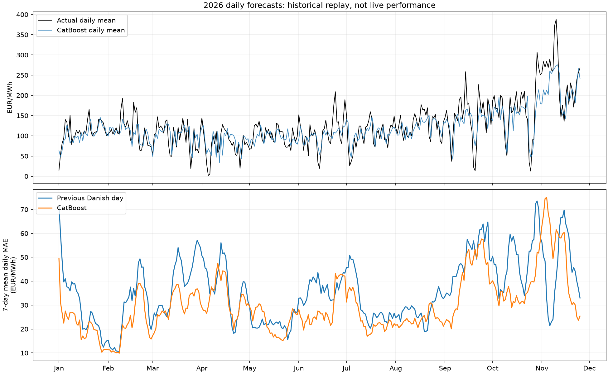
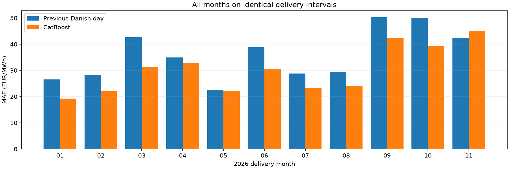
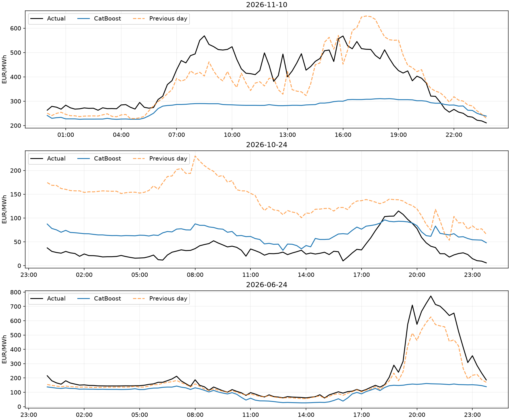

# DK2 electricity-price forecasting: 2026 year-to-date review

**Draft for review — historical research results, not live trading performance.**

## Scope and controls

We forecast every quarter-hour for **1 January–25 November 2026**: 329 Danish delivery days and **31,584 paired intervals**, with 100% forecast coverage. Target issuance is 10:00 Europe/Copenhagen on the preceding day, with the declared 09:50 input cutoff.

Each forecast receives the preceding Danish day's actual prices, earlier price history and calendar features. The existing CatBoost configuration is held fixed; weights are refitted weekly on its Friday schedule and inputs refreshed daily. October–December 2025 provide initial training history. No target-day prices enter features or training labels. Historical publication/revision vintages are assumed, not verified.

Both clock changes are included (92 and 100 quarters). Previous-day matching uses Danish clock time and the earlier UTC occurrence for repeated source slots. Four missing spring source slots use the frozen weekly fallback. All predictions are marked as replays.

## Headline results

| Method | MAE EUR/MWh | RMSE | Within ±€25 | Within ±€50 |
| --- | ---: | ---: | ---: | ---: |
| Previous Danish day | 35.80 | 54.27 | 54.0% | 75.1% |
| Weekly UTC | 49.12 | 72.58 | 42.8% | 64.7% |
| CatBoost | 30.00 | 46.24 | 58.0% | 82.0% |

CatBoost reduces MAE by **16.2%** against the primary benchmark. It wins on **215/329 days** (65.3%) and has lower monthly MAE in **10/11 months**. Its mean signed error is **-6.40 EUR/MWh**: prices are underpredicted on average.

## Where performance weakens

| Actual-price regime | Intervals | Previous-day MAE | CatBoost MAE |
| --- | ---: | ---: | ---: |
| Negative prices | 371 | 9.66 | 40.48 |
| At least €200/MWh | 4,072 | 59.55 | 68.80 |
| Extreme prices | 1,107 | 95.79 | 127.21 |

The extreme threshold is fixed from development at |price| ≥276.019989 EUR/MWh. These slices overlap. CatBoost is worse in all three despite improving the average. It overpredicts negative prices and substantially underpredicts high prices.

**November through the 25th is the losing month:** CatBoost MAE is €45.19/MWh versus €42.49 for persistence. On 10 November, CatBoost's daily MAE reached €118.73 versus €58.38 for the baseline. These failures matter for an energy-trading application.

## Monthly consistency

| Month | Days | Previous-day MAE | CatBoost MAE |
| --- | ---: | ---: | ---: |
| 2026-01 | 31 | 26.49 | 19.24 |
| 2026-02 | 28 | 28.31 | 22.00 |
| 2026-03 | 31 | 42.66 | 31.40 |
| 2026-04 | 30 | 34.92 | 32.90 |
| 2026-05 | 31 | 22.58 | 22.14 |
| 2026-06 | 30 | 38.75 | 30.54 |
| 2026-07 | 31 | 28.83 | 23.25 |
| 2026-08 | 31 | 29.48 | 24.12 |
| 2026-09 | 30 | 50.28 | 42.46 |
| 2026-10 | 31 | 50.08 | 39.42 |
| 2026-11 | 25 | 42.49 | 45.19 |

## Assessment and publication limits

**There is a useful average forecasting signal, but these results do not establish trading-desk readiness.** The model is competitive with persistence overall, while its negative-price and spike failures require further work. No trading strategy, costs, positions or P&L have been tested.

Much of 2026 was already used for earlier model development, current candidate selection or inspected diagnostics. The post-freeze November dates were also replayed earlier. Training is chronological, but this entire retrospective comparison is selection-affected; it is not an untouched annual test. Any later tuning on these results must retain that status.

The full appendix retains daily/monthly statistics, error percentiles, signed errors, hourly/weekend groups, fixed-rule failure cases and exploratory paired-day block resampling. Its uncertainty intervals are unadjusted for selection and multiple comparisons.

## Verification and reproduction

**63 automated tests passed**, plus Ruff lint, formatting and dependency checks. Independent verification matched all 31,584 actual-price keys and previous-day inputs, 329 receipts and 48 training origins. Direct DuckDB calculations reproduced the reported metrics. The earlier 20–25 November predictions matched exactly; neither clock-change day was dropped.

Run the Windows CMD commands in the [README](../README.md#replay-every-delivery-day-in-2026). They recreate the immutable daily forecasts, model checkpoints, complete interval CSV/Parquet and detailed report under ignored `data/year_replays`. The retained code/configuration hashes are listed in [the provenance manifest](../configs/annual-replay-provenance.json). Fresh downloads may contain revised values; exact replay requires the retained raw capture.

Run ID: `8606b681b3bdea2401ac8f3981e206329d2e9ee74f25ed23659f0bdf83ae2aa0`. Candidate: `326385f66d1c7f75ecbdb67cd8dce96d7656033a366c1f1225120de18f6d5e62`. Data: `98cbae7df46931e31b00073d145c553cf21c09dfe64a7cd3b582ca4a9ad0b2d6`. A machine-readable [summary](year-to-date-2026-11-25.json) preserves the figures and limitations.

**No commit, push, repository or GitHub release has been created. All automatic tasks remain disabled.** This draft is ready for review, with the weaknesses included.

